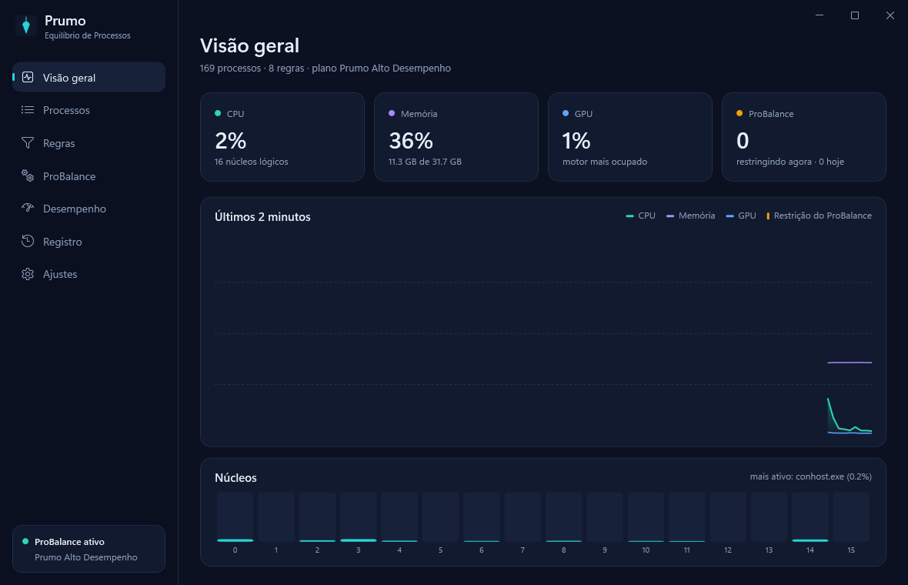
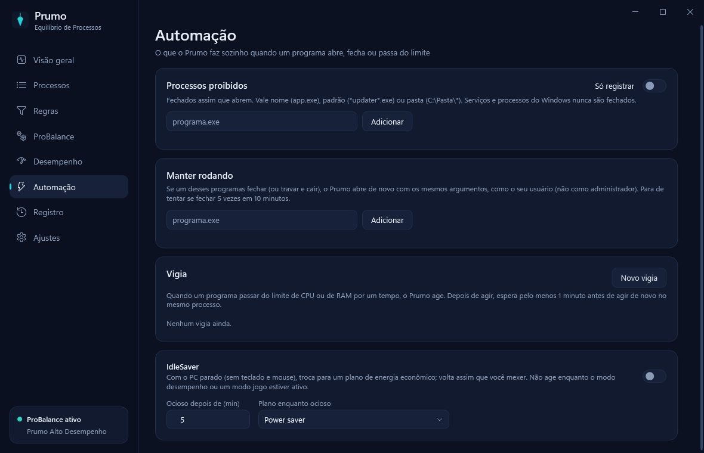

# Prumo

**Equilíbrio de Processos para Windows.** Uma alternativa leve, bonita e de código aberto ao Process Lasso: mantém o PC respondendo quando algum programa em segundo plano dispara o uso de CPU, e aplica sozinho as prioridades, afinidades e planos de energia que você escolher para cada programa.

Sem tela de propaganda na inicialização, sem conta, sem telemetria.



## O que ele faz

**ProBalance**: quando a CPU total passa de um limite e um processo em segundo plano fica acima da cota por um tempo, a prioridade dele cai para *Abaixo do normal* (ou *Ociosa*) e volta ao normal quando ele se acalma. O programa em primeiro plano, os filhos dele e os serviços ficam de fora.

**Regras por programa ou por pasta** (`jogo.exe`, `*updater*.exe` ou `C:\Steam\steamapps\common\*`):
- prioridade de CPU, de I/O, de GPU e de memória
- afinidade (CPUs fixas) e CPU Sets (CPUs preferidas)
- modo de eficiência (EcoQoS) ligado ou desligado, boost dinâmico de prioridade
- GPU preferida (dedicada ou integrada)
- limitador de CPU: acima de X%, fica restrito a N núcleos por T segundos
- **modo jogo**: troca o plano de energia enquanto o programa está aberto
- impedir a suspensão do PC enquanto o programa roda
- "Adicionar jogos": cria uma regra por biblioteca (Steam, Epic, Xbox, Riot...) com o preset de jogo

**Automação**
- **Processos proibidos**: fechados assim que abrem (ou só registrados)
- **Manter rodando**: se o programa fechar ou cair, abre de novo com os mesmos argumentos, como o seu usuário
- **Vigia**: se um programa passar de X% de CPU ou X MB de RAM por um tempo, registra, reduz a prioridade, libera memória, reinicia ou fecha
- **IdleSaver**: plano de energia econômico quando o PC fica parado

**Desempenho**: boost do programa em primeiro plano, modo desempenho (mantém um plano de energia), SmartTrim (libera memória de processos em segundo plano e limpa a lista de espera quando a RAM aperta) e resolução do timer do sistema.

**Limpeza** (o que vale a pena do Mem Reduct e do Microsoft PC Manager):
- **Limpar memória agora**: memória de programas em segundo plano, cache de arquivos do sistema, lista modificada, lista de espera (só baixa prioridade ou toda), páginas iguais e cache do registro; nunca mexe no programa em foco nem em jogos com regra. Também pelo ícone da bandeja, pelo atalho **Ctrl+F1** e sozinho quando a RAM passa de X%
- **Arquivos que sobram**: temporários, downloads do Windows Update, Otimização de Entrega, relatórios de erro, despejos de memória e Lixeira, com análise do tamanho real em disco antes de apagar. Cache de shaders e dados de navegador ficam de fora de propósito
- **Programas que abrem com o Windows**: liga e desliga do mesmo jeito que o Gerenciador de Tarefas (reversível, nada é apagado)
- **Limpar cache de DNS**

**Interface**: gráficos de CPU por núcleo, memória, GPU e restrições do ProBalance; lista de processos com menu de contexto; registro com busca e exportação; ícone na bandeja que mostra a carga da CPU; temas **Azul**, **Claro** e **Preto** (OLED).



## Instalação

Requisitos: Windows 10/11 x64 e o [.NET 8 Desktop Runtime](https://dotnet.microsoft.com/download/dotnet/8.0) (para compilar, o .NET 8 SDK).

```powershell
git clone https://github.com/iSamigor/Prumo.git
cd Prumo
# num PowerShell como administrador:
powershell -ExecutionPolicy Bypass -File tools\install.ps1
```

O script compila, instala em `C:\Program Files\Prumo`, cria atalhos na área de trabalho e no menu Iniciar e registra uma tarefa agendada que abre o Prumo no login, já como administrador e sem pedido do UAC.

Opções:
- `-GameBoost`: já liga as otimizações para jogos (regras das bibliotecas de jogos, modo desempenho, boost de primeiro plano, SmartTrim, timer de 0,5 ms)
- `-KeepLasso`: não mexe no Process Lasso. Sem essa opção, se ele estiver instalado, o serviço dele é parado e desativado (não desinstalado; `-RestoreLasso` religa), porque os dois brigariam pelas mesmas prioridades.
- `-Uninstall` (com `-KeepConfig` para guardar a configuração): remove o Prumo

Na primeira vez, se existir um `prolasso.ini`, as regras e o ProBalance do Process Lasso são importados.

## Configuração

Fica em `%ProgramData%\Prumo\config.json` (só administradores podem alterar essa pasta, porque o arquivo controla um processo elevado). Em **Ajustes > Backup da configuração** dá para exportar, importar e restaurar os padrões. O registro de eventos fica em `%ProgramData%\Prumo\logs`. Ao atualizar de uma versão antiga, a pasta recebe permissões só de administrador na primeira execução; arquivos criados antes disso mantêm as permissões antigas até serem regravados.

## Por que precisa de administrador

Mudar prioridade, afinidade e I/O de processos de outros usuários e serviços, trocar o plano de energia, limpar a lista de espera da memória e ajustar o timer exigem privilégios de administrador. Programas que o Prumo reabre (manter rodando, vigia) são iniciados como o usuário comum, nunca como administrador.

## Limitações conhecidas

- A interface está só em português do Brasil.
- O motor lê os processos uma vez por segundo: uma regra é aplicada até 1 s depois que o programa abre, e processos que vivem menos que isso podem passar sem regra.
- Afinidade e CPU Sets usam os primeiros 64 processadores lógicos (um grupo de processadores).
- O executável não é assinado; o SmartScreen pode avisar na primeira execução.
- Alguns jogos com anti-cheat em modo kernel bloqueiam a mudança de prioridade; o Prumo tenta de novo a cada 30 s e registra a falha.

## Compilar

```powershell
dotnet build src\Prumo\Prumo.csproj -c Release
```

C# / .NET 8 / WPF, sem dependências externas. O motor (`src/Prumo/Core/Engine.cs`) roda numa thread própria e lê os processos com `NtQuerySystemInformation`; a interface só edita a configuração, que o motor recebe como uma cópia imutável.

## Licença

[MIT](LICENSE)
